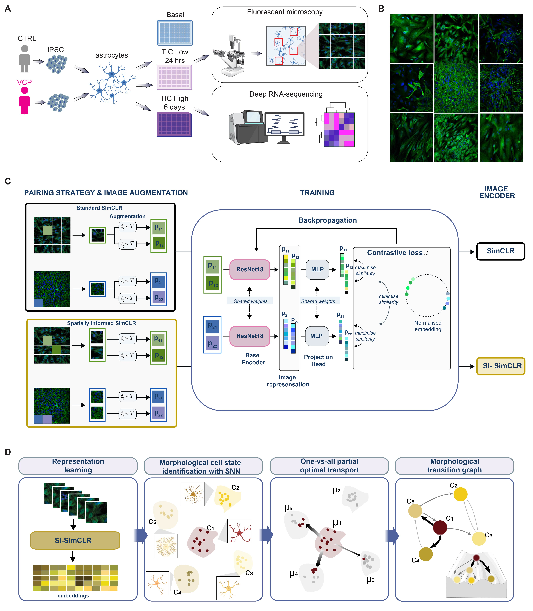

# SI-SimCLR: A spatially informed self-supervised framework for microscopy datasets

This repository contains the code for our paper [...]. It includes the implementation of SI-SimCLR, our custom contrastive learning approach, along with our full analysis pipeline and Docker-based training environments.



The fluorescence microscopy astrocyte dataset employed to train our models is accessible on [Zenodo](10.5281/zenodo.19553134). 

Codebase lineage: The foundational SimCLR framework in this repository is adapted from the PyTorch implementation of [SCAN: Learning to Classify Images without Labels](https://doi.org/10.1007/978-3-030-58607-2_16) (Van Gansbeke et al.). The original SCAN code was released under a [Creative Commons license](https://github.com/wvangansbeke/Unsupervised-Classification/blob/master/LICENSE).
We repurposed their base SimCLR structure and extended the framework by introducing our **SI-SimCLR** formulation and downstream analysis.

## SI-SimCLR Training Guide

This document provides a clean, reproducible training workflow for installation on local machine. To launch SI-SimCLR on a cluster, you can use [SI-SimCLR/simclr.sh](SI-SimCLR/simclr.sh).

## Overview

Main training components:
1. [SI-SimCLR/simclr.py](SI-SimCLR/simclr.py): training entrypoint.
2. [configs/env.yml](configs/env.yml): machine and output paths.
3. [configs/debug/simclr_acs.yml](configs/debug/simclr_acs.yml): experiment hyperparameters.
4. [utils/mypath.py](utils/mypath.py): annotation CSV mapping.

## 1. Installation

Local environment setup (conda):

```bash
conda install mamba -n base -c conda-forge
mamba env create -f environment.yml
conda activate si-simclr
```

## 2. Configure Paths

Edit [configs/env_template.yml](configs/env_template.yml):
1. image_root_dir: microscopy image directory.
2. embeddings_root_dir: where embeddings after training/inference are saved (or loaded for downstream analysis).
3. results_root_dir: where model checkpoints and summary files are saved.
4. analysis_results_root_dir: where analysis outputs are saved.
5. temp_results_root_dir: where temporary analysis outputs are saved.

Afterwards, set the name of the file to ```env.yml```

Example:
```
root_dir: ../
image_root_dir: /path/to/images
embeddings_root_dir: embeddings
results_root_dir: results
analysis_results_root_dir: results/analysis
temp_results_root_dir: results/temp
```
Note:
Annotation CSV paths are handled in [utils/mypath.py](utils/mypath.py).
To use our [astrocyte fluorescence microscopy dataset](10.5281/zenodo.19553134):
1. upload ```annotations_processed_crops.csv``` to [data](data)
2. add the corresponding path in [utils/mypath.py](utils/mypath.py)

## 3. Use on Local Machine

Run from repository root:

```bash
python SI-SimCLR/simclr.py \
  --config_env configs/env.yml \
  --config_exp configs/debug/simclr_acs.yml
```

To switch experiments, change only the config_exp argument. The key `pairing_strategy` in config_exp specifies how positive pairs are defined during training:
- `adjacent_neighbors` for SI-SimCLR
- `augmentations` for standard SimCLR

## 4. Use on SLURM
Run from ```SI-SimCLR```:

```bash
sbatch SI-SimCLR/simclr.sh
```

## 5. Output Structure

For experiment debug:
1. results/debug/pretext: model checkpoints.
2. results/debug/losses_train.pickle: training loss history.
3. embeddings/debug: latent embeddings.
4. results/exp_summary.csv: global training summary table, where information about all your experiments is stored.

## 6. Troubleshooting

1. Missing images:
Set image_root_dir correctly in [configs/env.yml](configs/env.yml).
2. Dataset not implemented:
Add mapping in [utils/mypath.py](utils/mypath.py).
